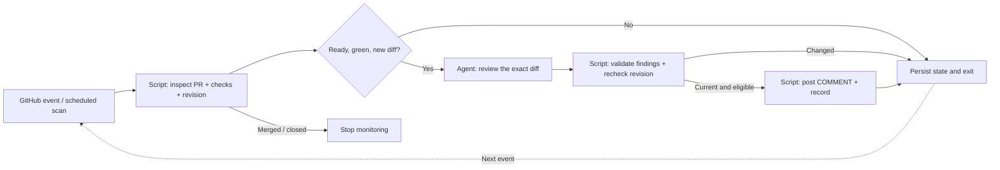

# dark-factory

An agentic software lifecycle whose control flow runs through deterministic code.
Agents are workers at explicit stages, not schedulers or polling loops.

**First working slice: the PR review lifecycle.** A Python controller inspects
GitHub, waits for configured checks, claims each eligible revision, invokes one
review worker, validates its findings, and publishes a COMMENT review when
explicitly enabled. Fabro + Kiro CLI is the initial worker adapter.

## The rule

> No new eligible work → no agent invocation.



Triggers, CI inspection, revision tracking, routing, waiting, deduplication and
publication never require an LLM. The review worker may use multiple model calls
inside its review stage.

## Try it now

Python 3.9+ is sufficient. The controller has no third-party Python dependencies.

```bash
python3 -m dark_factory demo
python3 -m unittest discover -s tests -v
```

The offline demo makes **zero GitHub requests and zero LLM calls**. It simulates
draft → ready/pending → green → duplicate trigger → new commit/pending → green
→ merged. Only the two eligible revisions invoke the deterministic fixture
reviewer.

With an authenticated [GitHub CLI](https://cli.github.com/), inspect this repo:

```bash
python3 -m dark_factory scan --repo f-jordao/dark-factory
python3 -m dark_factory reconcile --repo f-jordao/dark-factory --pr 1
python3 -m dark_factory status
```

These commands inspect GitHub and update local state. They do not invoke agents
or publish comments without the corresponding flags.

## Connect a real review worker

**Fabro → native Kiro ACP has been exercised with your existing CLI login.**
The known-bug fixture produced the expected finding, the clean fixture produced
no findings, and a duplicate controller trigger reused its saved result.
No LLM provider API key was supplied to Fabro.

Start the project-local runtime, then exercise the same controller with an
offline packet. This pilot calls the real agent when `--execute` is present,
and cannot publish to GitHub:

```bash
python3 scripts/local_fabro.py start
python3 -m dark_factory pilot --fixture known-bug --execute
python3 -m dark_factory pilot --fixture known-bug --execute
python3 -m dark_factory pilot --fixture clean --execute
```

Fabro's built-in web UI is enabled on the loopback address printed by `start`.
It shows real worker runs, stages, logs and timing. Browser sign-in uses the
project's private dev token; the existing API authentication remains enabled.
The separate demand-to-merge diagram is an illustrative lifecycle design.

The second identical invocation reports `review_invocations: 0`. Results are in
`.dark-factory/runs/<review-key>/output.json`, with Fabro exports and run identity
inside the attempt directory. Pilot readiness is synthetic fixture data; it
never substitutes for CI on a real PR.

See [Fabro setup](docs/fabro-setup.md) for requirements, authentication,
cancellation verification and runtime management. For a real GitHub PR:

```bash
cp config.example.json config.local.json
# Set required_checks to the exact checks required for the repository.
python3 -m dark_factory reconcile \
  --repo f-jordao/dark-factory --pr 1 --config config.local.json --execute
```

`--execute` permits the eligible worker to run, but does not post anything.
Inspect the saved findings in `.dark-factory/runs/<review-key>/output.json`.
Publish saved findings independently:

```bash
python3 -m dark_factory reconcile \
  --repo f-jordao/dark-factory --pr 1 --config config.local.json --publish
```

Once a worker has been exercised and validated, both flags can be used together.
`scan` accepts the same flags and processes open and previously tracked PRs.
It is a one-shot script suitable for an external scheduler. This repository
does not install a schedule or enable an autonomous review bot.

## What is implemented

- GitHub inspection through existing `gh` authentication.
- Exact configured check names; missing, pending, failed, skipped, neutral or
  ambiguous required checks block the review. No configured checks also blocks it.
- SQLite state for PR observations, review results and concurrent process claims.
- Review identity includes repository, PR, head SHA, base SHA and policy digest.
- Prompt, workflow, worker-profile and configured worker-source changes invalidate
  previous review identity.
- Eligibility checked before reasoning and again before publication.
- Results saved before publication; posting failures reuse the saved result.
- A durable marker identifies reviews already accepted by GitHub after an
  interrupted request. Only reviews authored by the authenticated account match.
- Findings checked against new-side diff lines; incomplete patches are rejected.
- Closed PRs leave active monitoring.
- Publication is always `COMMENT`, never approval, change request or merge.
- The Fabro run identity is persisted before execution. Timeout or interruption
  requests server-side cancellation and records whether it was confirmed.
- Kiro receives the packet in its prompt, returns JSON, and has a tool-denial
  profile. The controller writes the result; the agent needs no file tools.

## Boundaries of this first slice

The controller and authenticated Fabro/Kiro review stage are exercised locally.
Review publication has controller tests but has not been exercised against a
real GitHub PR. Hosted CI must become available before the green-check PR pilot.

Review context is currently the changed-file patches, PR description and selected
root standards files at the pinned base SHA. It does not yet retrieve linked
issues, nested standards, unchanged source files or test results. Missing or
incomplete patches require human handling rather than a partial automated review.

The final revision check is followed by a GitHub write, so a commit can still arrive
between those operations. `commit_id` pins the posted review to its reviewed head;
it does not make the read and write atomic. Native required-review enforcement
belongs in GitHub rulesets.

The local Fabro adapter runs on the same machine and user account. Its native
Kiro profile denies tools and its ACP proxy refuses permission callbacks; the
successful pilot exports contained no tool events. A separate production worker
should receive only its review packet, with no controller publication credential.

## Where this is going

The full lifecycle is documented in [Demand to merge](docs/lifecycle.md):
intake → demand type → blast-radius evidence → human gates → implementation
→ verification → review → merge eligibility.

The review prompt keeps Matt Pocock's **Standards** and **Spec** axes separate.
It is a project-authored adaptation, not his installed skill.
See [skill integration](docs/skills.md) and [next milestones](ROADMAP.md).

The earlier framework comparison is retained as
[research context](docs/research.md). This README and the architecture decisions
describe the current direction.

## Verification

See [verification status](docs/verification.md) for the exercised cases and
limitations. Local tests and Fabro validation pass. GitHub-hosted CI is unable
to start because GitHub reports an account billing or spending-limit issue.
