# Demand to merge

This is the target architecture. Its six demand routes and seven shared flows are
now scaffolded in the [workflow catalog](workflows.md), with stage content pending.
The PR review controller is the implemented slice; durable demand routing and
trusted approval execution remain future milestones.

```mermaid
flowchart LR
    request["Request / idea"] --> intake["Trusted intake"]
    bug["Bug / incident"] --> intake
    maintenance["Maintenance / security"] --> intake
    intake --> category["Demand type"]
    category --> evidence["Blast-radius evidence"]
    evidence --> policy["Deterministic routing policy"]
    policy --> discovery["Discovery / missing evidence"]
    policy --> small["Local, bounded change"]
    policy --> broad["Shared, sensitive or broad change"]
    discovery --> decision["Human: decide scope"]
    decision --> plan["Agent: plan or diagnose"]
    small --> plan
    broad --> approval["Human: approve approach"]
    approval --> plan
    plan --> implement["Agent: implement"]
    implement --> verify["Scripts: tests and checks"]
    verify --> radius["Scripts + evidence: reassess actual diff"]
    radius --> review["Agent: independent review"]
    review --> publish["Scripts: validate and publish"]
    publish --> mergeGate["GitHub: required checks and human reviews"]
    mergeGate --> merge["Merge"]
```

Classification is separate from risk. A bug may alter authentication across
services; a feature may change one local helper. A label describing the request
does not prove the change's blast radius.

| Demand | Typical work stages | Human decision to preserve |
|---|---|---|
| Bug | Reproduce → diagnose → regression test → implement → review | Unclear expected behavior or a broad fix |
| Feature | Clarify → specification → plan → implement → verify → review | Scope, acceptance criteria and consequential design |
| Maintenance | Inspect → bounded change → verify → review | Compatibility, shared dependencies or migration |
| Security | Assess → controlled fix → verify → review | Security ownership and change approval |
| Incident | Diagnose → containment proposal → fix → verify | Operational authority and production impact |
| Discovery | Investigate → evidence and recommendation | Authorize a subsequent implementation demand |

## Evidence and approval policy

Record touched components, affected consumers, public interfaces, data changes,
reversibility and ownership. Treat incomplete evidence as a human decision point.
Reassess using the actual implementation diff before merge.

An approval must identify the approver, demand, stage, revision and approved scope.
Material changes invalidate it. Agents cannot invent approval or turn a missing
answer into acceptance. GitHub's required reviews and rulesets enforce merge.

The policy above is project design, not a feature claimed to ship in Fabro.

## What executes each stage

| Responsibility | Executor |
|---|---|
| Scheduling, events and polling | Deterministic scripts / external scheduler |
| Reading GitHub state and evidence | Scripts and APIs |
| Choosing a configured route | Deterministic policy |
| Clarification, planning, diagnosis, implementation, review | Explicit agent stages |
| Human decisions | Trusted approval interface and GitHub reviews |
| Running checks and publishing validated artifacts | Scripts |
| Merge eligibility | GitHub rulesets and current revision |

Agents may help interpret evidence at a named analysis stage. The output is
recorded and validated; it does not replace trusted policy or approval identity.
