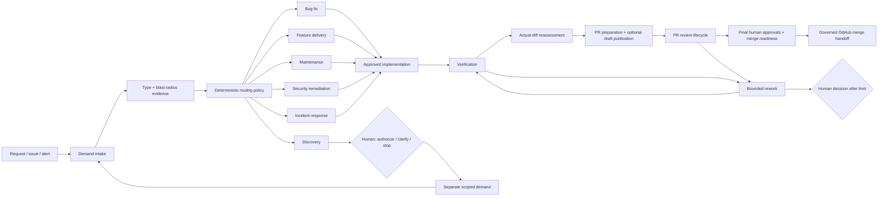

# Workflow setup

The complete lifecycle structure is scaffolded: six demand routes and seven shared
flows. Stage content is intentionally pending. The existing, exercised
`workflows/pr-review` worker is separate from these new disabled definitions.



## Demand routes

| Workflow | Structure | Main human decisions |
|---|---|---|
| [Bug fix](../workflows/bug-fix/README.md) | Reproduce → diagnose → regression design → plan → implement | Ambiguous expected behavior; material or critical plan; renewed scope |
| [Feature delivery](../workflows/feature-delivery/README.md) | Clarify → scope → specification → plan → implement | Acceptance and scope; plan; renewed scope |
| [Maintenance](../workflows/maintenance/README.md) | Compatibility evidence → plan → bounded update | Shared or sensitive change; compatibility and scope |
| [Security remediation](../workflows/security-remediation/README.md) | Threat/exposure assessment → remedy plan → controlled fix | Service owner and security owner plan decision |
| [Incident response](../workflows/incident-response/README.md) | Diagnose → containment proposal → authority → hotfix plan → implement | Operational authority; owner and specialist plan decision |
| [Discovery](../workflows/discovery/README.md) | Investigate → assess reach → recommendation → decision | Authorize a separate demand, clarify, or stop |

All five change routes prepare an isolated branch and hand off to verification,
actual-diff reassessment, PR preparation, independent review and merge readiness.
Discovery has no implementation or
merge path. Incident containment is a proposal, not an automated production action.

## Shared flows

| Workflow | Responsibility |
|---|---|
| [Demand intake](../workflows/demand-intake/README.md) | Validate the demand, normalize a trusted type, collect evidence and route; ask a human when type is unknown |
| [Verification](../workflows/verification/README.md) | Run configured checks and persist evidence; failures hand off to rework |
| [Actual-diff reassessment](../workflows/diff-reassessment/README.md) | Assess the real diff, update risk, invalidate expanded or stale scope and renew approval |
| [PR preparation](../workflows/pr-preparation/README.md) | Describe a verified change, validate its revision and optionally publish a draft PR when explicit write policy permits it |
| [PR review lifecycle](../workflows/pr-review-lifecycle/README.md) | Deterministic readiness, revision claim, one explicit review stage, result validation/save, optional COMMENT publication and observation |
| [Merge readiness](../workflows/merge-readiness/README.md) | Specialist acceptance when required, code-owner acceptance, fresh checks and governed GitHub handoff |
| [Rework](../workflows/rework/README.md) | At most two repairs, then a human decision; new work re-enters verification, reassessment and review |

Polling, waiting, scheduling, claims, saving, publication and merge checks are
script slots. They contain no agent stage. Agents appear only where substantive
analysis, planning, implementation or review is intended.

## Structure and content are separate

- [Workflow catalog](../workflows/catalog.json): the registered structure.
- Each `workflows/<name>/definition.json`: nodes, edges, conditions, role slots,
  approval record fields, shared handoffs and limits.
- Each `workflow.fabro`, `workflow.toml` and workflow `README.md`: generated
  Fabro graph, run configuration and visual map.
- [Stage catalog](../stages/catalog.json): 77 shared stage templates with executor,
  input and output slots.
- `stages/<agent-stage>/prompt.md`: 17 empty method/input/output templates.
  Matt Pocock candidates are references only; no upstream skills are installed.
- [Routing policy](../policy/routing.json): the agreed R1/R2/R3 and Discovery
  structure. R0 is reserved for a later explicit allowlist.
- [Demand](../contracts/demand.schema.json),
  [approval](../contracts/approval.schema.json) and
  [stage-result](../contracts/stage-result.schema.json) envelopes: structural
  contracts for future implementations.

Approval records also identify their workflow, stage and target branch.
The JSON schemas describe record shape; trusted identity verification, role
checks, persistence and approval invalidation still require implementation.
Native Fabro human choices do not supply that enforcement by themselves.
Shared handoffs declare composition points; they do not yet launch child flows.

Every generated graph starts with a deterministic guard that fails before work.
Script slots also fail, and agent slots use an inert ACP command. Filling a prompt
does not activate the workflow. Activation is a later implementation milestone.
The guard's goal gate has no retry target intentionally: no automatic reasoning
or retries should occur while stage content is missing.
Graph progress from command and agent slots requires `outcome=succeeded`;
the fallback terminates. A failed command alone does not stop Fabro from
following an unconditional edge, so the guard explicitly routes failure to exit.
Verification scripts belong in an isolated verification worker, not in the
controller that reads PR content.

## Inspect or rebuild

These commands make no GitHub or model calls:

```bash
python3 -m dark_factory workflows list
python3 -m dark_factory workflows show feature-delivery
python3 -m dark_factory workflows route --demand bug --blast-radius shared
python3 -m dark_factory workflows route --demand exploration
python3 -m dark_factory workflows validate
python3 -m dark_factory workflows build
```

With the pinned Fabro runtime installed, validate all native graphs and exercise
one deterministic guard without invoking an agent:

```bash
python3 scripts/verify_workflow_scaffolds.py --guard-smoke
```

Edit structure in `definition.json` and shared stage metadata in
`stages/catalog.json`. `build` regenerates graph/config/map files; it does not
overwrite prompt files or the existing working PR-review adapter.

## Fabro visibility

Fabro's native workflow catalog remains unavailable in the installed version.
The supported **Automations** page can hold these definitions with their sole
API trigger disabled and no schedule. They are visible placeholders, not
operational automations.

The initial local registration is complete and visible in Fabro. All 13
definitions are pinned to scaffold commit
`dd6ae769b5e3b58b7967dcb1f3ba3b6ec53533b5`. A later documentation commit
does not change that source. Their Run buttons are disabled.

After publishing the scaffold commit:

```bash
python3 scripts/register_workflows.py --ref <full-published-commit-sha>
python3 scripts/register_workflows.py --ref <full-published-commit-sha> --apply
```

Registration pins each target to that immutable commit, verifies disabled
triggers, and creates no run. Repeating it with the same definitions creates
no duplicates. If an existing definition differs, it is left untouched and the
command stops before writing. It does not enable, schedule or replace anything.
Use the same pinned ref when repeating verification of the initial registration.
Updating a target revision is a separate explicit change.

## Fill content next

For each stage, add its substantive method, input validation, output contract,
failure handling and execution binding. For human gates, add a decision packet
and the trusted actor/role/revision validator. For script stages, add deterministic
implementations. Then wire the shared handoffs and exercise the complete route
before enabling any trigger.
