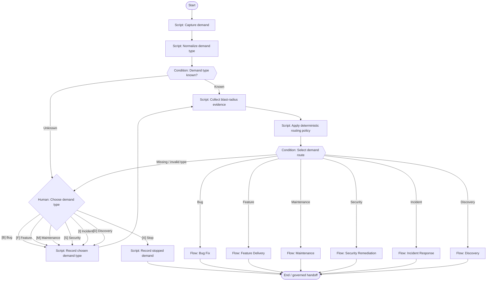

# Demand intake & routing

Capture, classify, assess evidence and select a demand route.

**Scaffold only.** Stage content, worker bindings, script implementations
and trusted approval validation are pending. Execution is disabled.



## Stage slots

| Stage | Executor | Content to add |
|---|---|---|
| Capture demand | script | Implementation / decision packet pending |
| Normalize demand type | script | Implementation / decision packet pending |
| Demand type known? | condition | Implementation / decision packet pending |
| Choose demand type | human | Implementation / decision packet pending |
| Record chosen demand type | script | Implementation / decision packet pending |
| Collect blast-radius evidence | script | Implementation / decision packet pending |
| Apply deterministic routing policy | script | Implementation / decision packet pending |
| Select demand route | condition | Implementation / decision packet pending |
| Record stopped demand | script | Implementation / decision packet pending |
| Bug Fix | handoff | [Shared flow](../bug-fix/README.md); dispatch binding pending |
| Feature Delivery | handoff | [Shared flow](../feature-delivery/README.md); dispatch binding pending |
| Maintenance | handoff | [Shared flow](../maintenance/README.md); dispatch binding pending |
| Security Remediation | handoff | [Shared flow](../security-remediation/README.md); dispatch binding pending |
| Incident Response | handoff | [Shared flow](../incident-response/README.md); dispatch binding pending |
| Discovery | handoff | [Shared flow](../discovery/README.md); dispatch binding pending |

Human approval records bind actor and roles to the demand, repository,
head, base, artifact digest, scope digest and policy version. A native
Fabro choice alone does not enforce those records or roles. Records
also identify the workflow, stage and target branch.

Repair is limited to two attempts; exhausted or unknown budgets require
a human decision. No automatic merge is defined.

Edit `definition.json` for structure and `../../stages/catalog.json`
for shared stage slots. Rebuild derived files with:

```bash
python3 -m dark_factory workflows build
```
