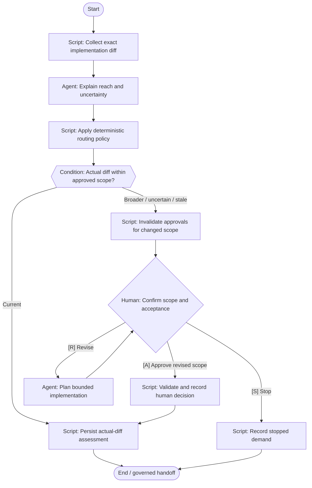

# Actual-diff reassessment

Reassess impact and invalidate stale or expanded-scope approvals.

**Scaffold only.** Stage content, worker bindings, script implementations
and trusted approval validation are pending. Execution is disabled.



## Stage slots

| Stage | Executor | Content to add |
|---|---|---|
| Collect exact implementation diff | script | Implementation / decision packet pending |
| Explain reach and uncertainty | agent | [Prompt](../../stages/analyze-impact/prompt.md) |
| Apply deterministic routing policy | script | Implementation / decision packet pending |
| Actual diff within approved scope? | condition | Implementation / decision packet pending |
| Invalidate approvals for changed scope | script | Implementation / decision packet pending |
| Confirm scope and acceptance | human | Implementation / decision packet pending |
| Validate and record human decision | script | Implementation / decision packet pending |
| Plan bounded implementation | agent | [Prompt](../../stages/plan/prompt.md); candidate skill `to-tickets` |
| Persist actual-diff assessment | script | Implementation / decision packet pending |
| Record stopped demand | script | Implementation / decision packet pending |

Human approval records bind actor and roles to the demand, repository,
head, base, artifact digest, scope digest and policy version. A native
Fabro choice alone does not enforce those records or roles. Records
also identify the workflow, stage and target branch.

Repair is limited to two attempts; exhausted or unknown budgets require
a human decision. No automatic merge is defined.

Edit `definition.json` for structure and `../../stages/catalog.json`
for shared stage slots. Rebuild derived files with:

```bash
python3 -m dark_factory workflows build
```
