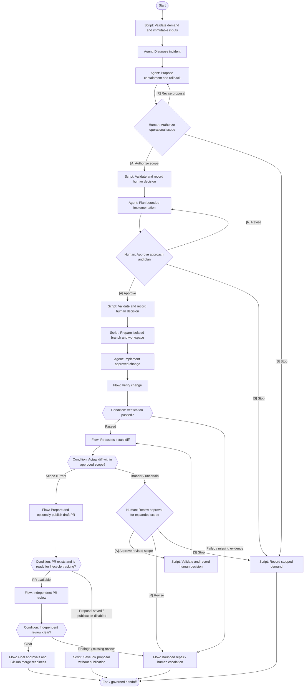

# Incident response

Diagnose, propose containment, obtain operational authority and prepare a minimal hotfix.

**Scaffold only.** Stage content, worker bindings, script implementations
and trusted approval validation are pending. Execution is disabled.



## Stage slots

| Stage | Executor | Content to add |
|---|---|---|
| Validate demand and immutable inputs | script | Implementation / decision packet pending |
| Diagnose incident | agent | [Prompt](../../stages/incident-triage/prompt.md); candidate skill `diagnosing-bugs` |
| Propose containment and rollback | agent | [Prompt](../../stages/containment-proposal/prompt.md) |
| Authorize operational scope | human | Implementation / decision packet pending |
| Validate and record human decision | script | Implementation / decision packet pending |
| Plan bounded implementation | agent | [Prompt](../../stages/plan/prompt.md); candidate skill `to-tickets` |
| Approve approach and plan | human | Implementation / decision packet pending |
| Validate and record human decision | script | Implementation / decision packet pending |
| Implement approved change | agent | [Prompt](../../stages/implement/prompt.md); candidate skill `implement` |
| Verify change | handoff | [Shared flow](../verification/README.md); dispatch binding pending |
| Verification passed? | condition | Implementation / decision packet pending |
| Reassess actual diff | handoff | [Shared flow](../diff-reassessment/README.md); dispatch binding pending |
| Actual diff within approved scope? | condition | Implementation / decision packet pending |
| Renew approval for expanded scope | human | Implementation / decision packet pending |
| Validate and record human decision | script | Implementation / decision packet pending |
| Independent PR review | handoff | [Shared flow](../pr-review-lifecycle/README.md); dispatch binding pending |
| Independent review clear? | condition | Implementation / decision packet pending |
| Final approvals and GitHub merge readiness | handoff | [Shared flow](../merge-readiness/README.md); dispatch binding pending |
| Bounded repair / human escalation | handoff | [Shared flow](../rework/README.md); dispatch binding pending |
| Record stopped demand | script | Implementation / decision packet pending |
| Prepare isolated branch and workspace | script | Implementation / decision packet pending |
| Prepare and optionally publish draft PR | handoff | [Shared flow](../pr-preparation/README.md); dispatch binding pending |
| PR exists and is ready for lifecycle tracking? | condition | Implementation / decision packet pending |
| Save PR proposal without publication | script | Implementation / decision packet pending |

Human approval records bind actor and roles to the demand, repository,
head, base, artifact digest, scope digest and policy version. A native
Fabro choice alone does not enforce those records or roles. Records
also identify the workflow, stage and target branch.

Repair is limited to two attempts; exhausted or unknown budgets require
a human decision. No automatic merge is defined.

Edit `definition.json` for structure and `../../stages/catalog.json`
for shared stage slots. Rebuild derived files with:

```bash
python3 -m dark_factory workflows build
```
