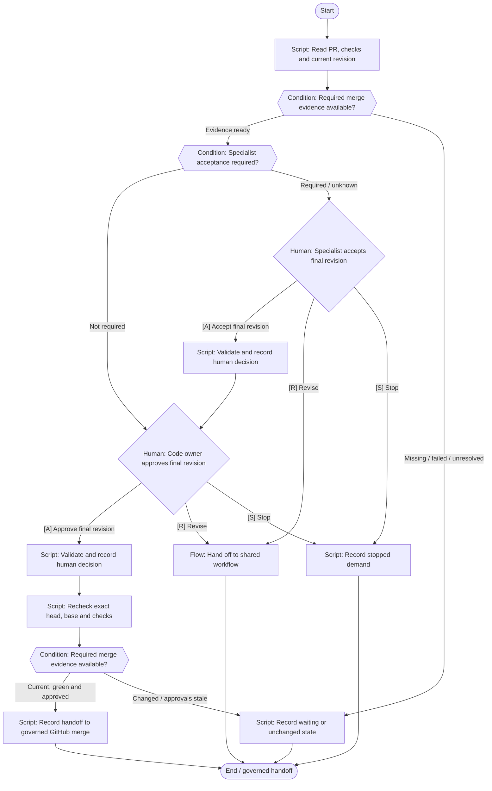

# Final approvals & merge readiness

Obtain revision-bound acceptance and hand off to governed GitHub merge; no merge action.

**Scaffold only.** Stage content, worker bindings, script implementations
and trusted approval validation are pending. Execution is disabled.



## Stage slots

| Stage | Executor | Content to add |
|---|---|---|
| Read PR, checks and current revision | script | Implementation / decision packet pending |
| Required merge evidence available? | condition | Implementation / decision packet pending |
| Specialist acceptance required? | condition | Implementation / decision packet pending |
| Specialist accepts final revision | human | Implementation / decision packet pending |
| Validate and record human decision | script | Implementation / decision packet pending |
| Code owner approves final revision | human | Implementation / decision packet pending |
| Validate and record human decision | script | Implementation / decision packet pending |
| Recheck exact head, base and checks | script | Implementation / decision packet pending |
| Required merge evidence available? | condition | Implementation / decision packet pending |
| Record handoff to governed GitHub merge | script | Implementation / decision packet pending |
| Record waiting or unchanged state | script | Implementation / decision packet pending |
| Hand off to shared workflow | handoff | [Shared flow](../rework/README.md); dispatch binding pending |
| Record stopped demand | script | Implementation / decision packet pending |

Human approval records bind actor and roles to the demand, repository,
head, base, artifact digest, scope digest and policy version. A native
Fabro choice alone does not enforce those records or roles. Records
also identify the workflow, stage and target branch.

Repair is limited to two attempts; exhausted or unknown budgets require
a human decision. No automatic merge is defined.

Edit `definition.json` for structure and `../../stages/catalog.json`
for shared stage slots. Rebuild derived files with:

```bash
python3 -m dark_factory workflows build
```
