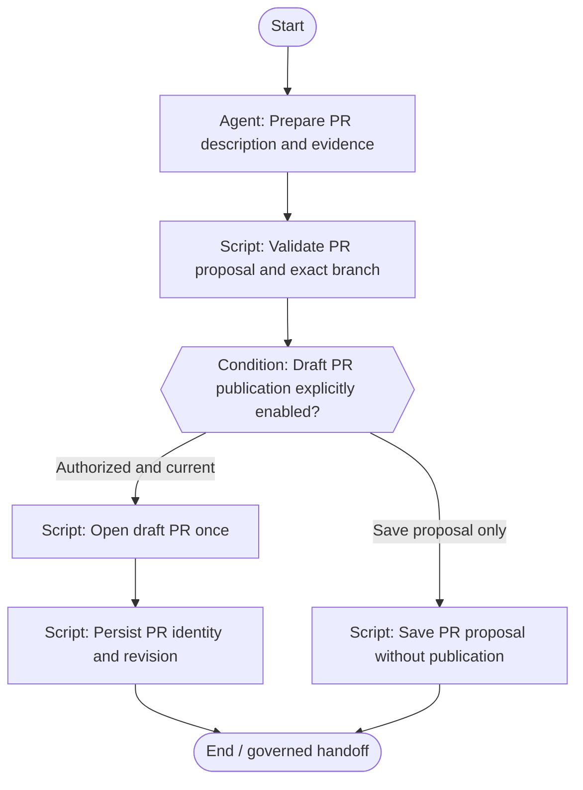

# PR preparation & draft publication

Describe the verified change and optionally publish a draft PR under explicit write policy.

**Scaffold only.** Stage content, worker bindings, script implementations
and trusted approval validation are pending. Execution is disabled.



## Stage slots

| Stage | Executor | Content to add |
|---|---|---|
| Prepare PR description and evidence | agent | [Prompt](../../stages/prepare-pr/prompt.md); candidate skill `pr` |
| Validate PR proposal and exact branch | script | Implementation / decision packet pending |
| Draft PR publication explicitly enabled? | condition | Implementation / decision packet pending |
| Open draft PR once | script | Implementation / decision packet pending |
| Persist PR identity and revision | script | Implementation / decision packet pending |
| Save PR proposal without publication | script | Implementation / decision packet pending |

Human approval records bind actor and roles to the demand, repository,
head, base, artifact digest, scope digest and policy version. A native
Fabro choice alone does not enforce those records or roles. Records
also identify the workflow, stage and target branch.

Repair is limited to two attempts; exhausted or unknown budgets require
a human decision. No automatic merge is defined.

Edit `definition.json` for structure and `../../stages/catalog.json`
for shared stage slots. Rebuild derived files with:

```bash
python3 -m dark_factory workflows build
```
