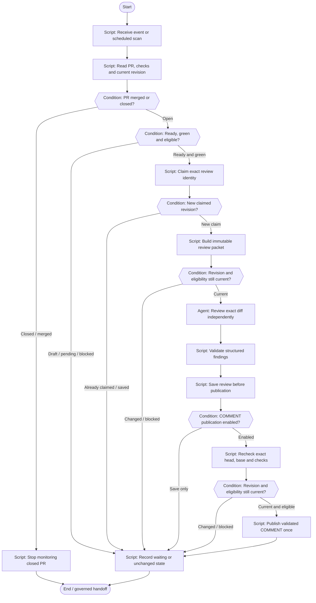

# PR review lifecycle

Inspect readiness, claim a new revision, review, save, optionally comment and observe.

**Scaffold only.** Stage content, worker bindings, script implementations
and trusted approval validation are pending. Execution is disabled.



## Stage slots

| Stage | Executor | Content to add |
|---|---|---|
| Receive event or scheduled scan | script | Implementation / decision packet pending |
| Read PR, checks and current revision | script | Implementation / decision packet pending |
| PR merged or closed? | condition | Implementation / decision packet pending |
| Stop monitoring closed PR | script | Implementation / decision packet pending |
| Ready, green and eligible? | condition | Implementation / decision packet pending |
| Claim exact review identity | script | Implementation / decision packet pending |
| New claimed revision? | condition | Implementation / decision packet pending |
| Build immutable review packet | script | Implementation / decision packet pending |
| Revision and eligibility still current? | condition | Implementation / decision packet pending |
| Review exact diff independently | agent | [Prompt](../../stages/independent-review/prompt.md); candidate skill `code-review` |
| Validate structured findings | script | Implementation / decision packet pending |
| Save review before publication | script | Implementation / decision packet pending |
| COMMENT publication enabled? | condition | Implementation / decision packet pending |
| Recheck exact head, base and checks | script | Implementation / decision packet pending |
| Revision and eligibility still current? | condition | Implementation / decision packet pending |
| Publish validated COMMENT once | script | Implementation / decision packet pending |
| Record waiting or unchanged state | script | Implementation / decision packet pending |

Human approval records bind actor and roles to the demand, repository,
head, base, artifact digest, scope digest and policy version. A native
Fabro choice alone does not enforce those records or roles. Records
also identify the workflow, stage and target branch.

Repair is limited to two attempts; exhausted or unknown budgets require
a human decision. No automatic merge is defined.

Edit `definition.json` for structure and `../../stages/catalog.json`
for shared stage slots. Rebuild derived files with:

```bash
python3 -m dark_factory workflows build
```
