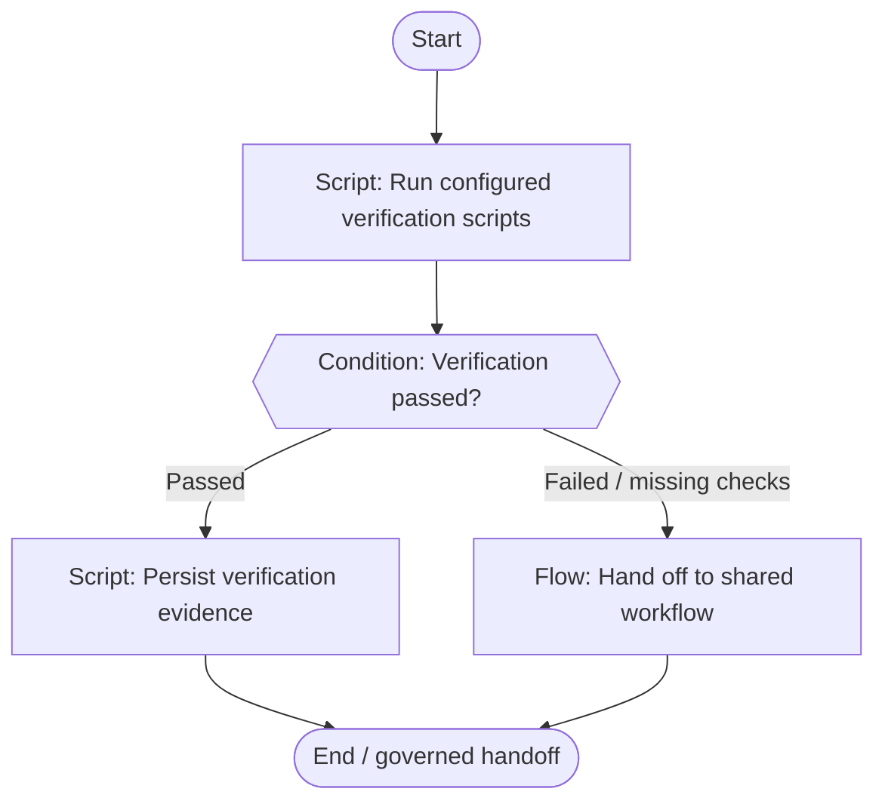

# Verification

Run configured checks and persist evidence for the exact revision.

**Scaffold only.** Stage content, worker bindings, script implementations
and trusted approval validation are pending. Execution is disabled.



## Stage slots

| Stage | Executor | Content to add |
|---|---|---|
| Run configured verification scripts | script | Implementation / decision packet pending |
| Verification passed? | condition | Implementation / decision packet pending |
| Persist verification evidence | script | Implementation / decision packet pending |
| Hand off to shared workflow | handoff | [Shared flow](../rework/README.md); dispatch binding pending |

Human approval records bind actor and roles to the demand, repository,
head, base, artifact digest, scope digest and policy version. A native
Fabro choice alone does not enforce those records or roles. Records
also identify the workflow, stage and target branch.

Repair is limited to two attempts; exhausted or unknown budgets require
a human decision. No automatic merge is defined.

Edit `definition.json` for structure and `../../stages/catalog.json`
for shared stage slots. Rebuild derived files with:

```bash
python3 -m dark_factory workflows build
```
